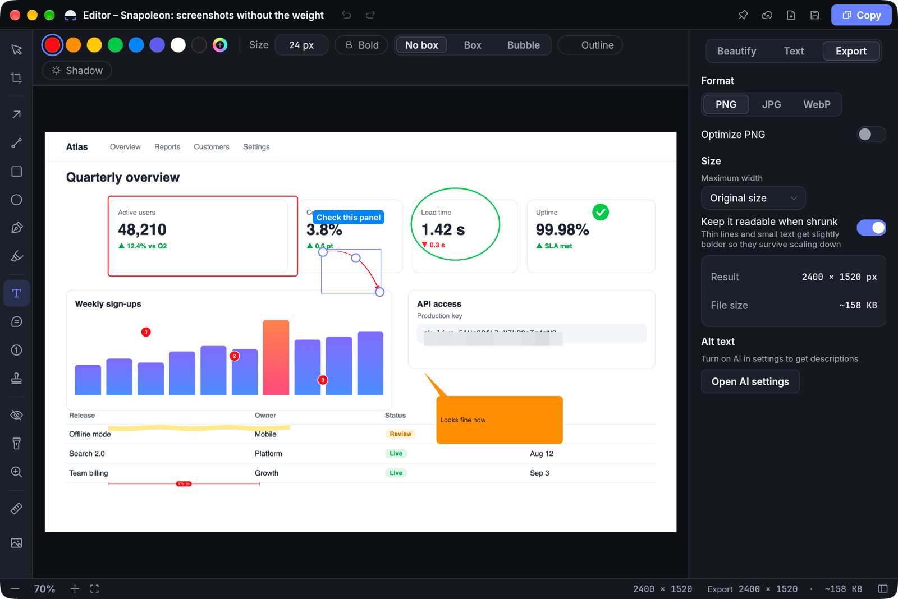
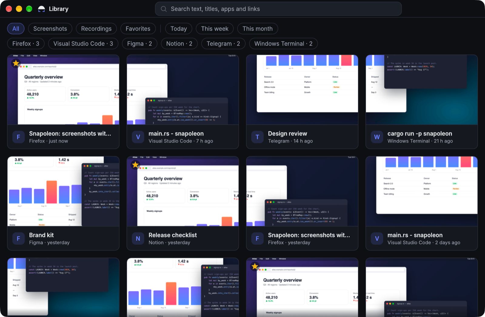
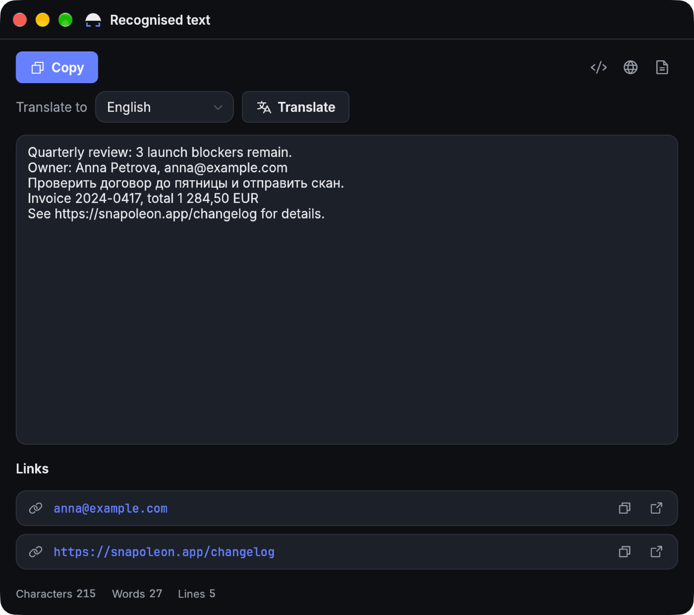
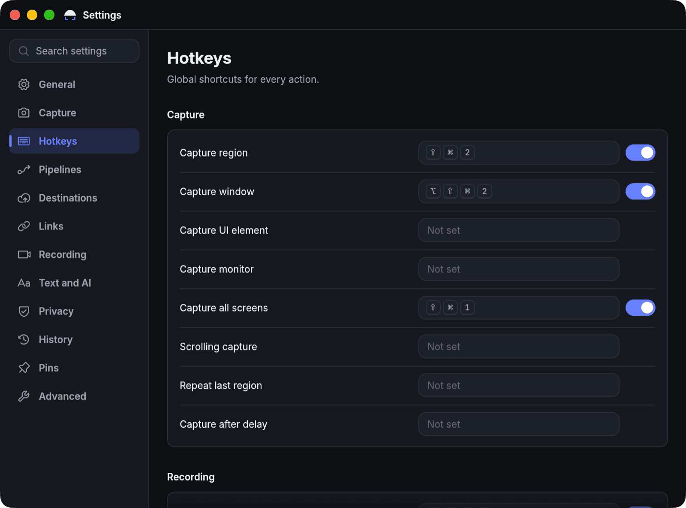

<p align="center">
  
</p>

<h1 align="center">Snapoleon</h1>

<p align="center">
  <b>One key. Drag. Done.</b><br>
  A fast, private screenshot and screen recording app for macOS, Windows and Linux.
</p>

<p align="center">
  <a href="https://github.com/EmpyEmpt/snapoleon/releases/latest"></a>
  
  <a href="#license"></a>
  
</p>

<p align="center">
  <a href="#download">Download</a> ·
  <a href="#what-it-does">Features</a> ·
  <a href="#getting-started">Getting started</a> ·
  <a href="#for-power-users-and-ai-agents">CLI and MCP</a> ·
  <a href="docs/INSTALL.md">Install guide</a>
</p>

<p align="center">
  
</p>

Snapoleon is a screenshot tool that stays out of your way. Press a shortcut, drag over what you want, and a small
toolbar appears right under your selection: copy it, save it, mark it up, pin it on top of your other windows, read
the text in it or record that area as a video. Everything happens on your computer. Nothing is uploaded unless you
add a place to upload to.

It is a single small native app, written entirely in Rust. No Electron, no browser engine, no background services.

## Download

| | |
|---|---|
| **macOS** 14 Sonoma or newer, Apple Silicon and Intel | [`Snapoleon-…-macos-universal.dmg`](https://github.com/EmpyEmpt/snapoleon/releases/latest) |
| **Windows** 10 1809 or newer, x64 and Arm | [`setup.exe`](https://github.com/EmpyEmpt/snapoleon/releases/latest) (no admin rights needed), `.msi` for IT, or a portable `.zip` |
| **Linux** x86_64 and aarch64 | [`AppImage`](https://github.com/EmpyEmpt/snapoleon/releases/latest), `.deb` or `.tar.gz` |

All files are on the [latest release](https://github.com/EmpyEmpt/snapoleon/releases/latest) page, with a
`SHA256SUMS` file to check them against.

> [!NOTE]
> The builds are not signed by Apple or Microsoft yet. On a Mac, the first time you open Snapoleon go to
> **System Settings > Privacy & Security** and click **Open Anyway**. On Windows, click **More info > Run anyway**
> in the SmartScreen prompt. The [install guide](docs/INSTALL.md) has the details.

## What it does

### Capture anything in two seconds

- **Region, window, whole screen, or one button.** The screen freezes the moment you press the shortcut, so menus
  and tooltips stay put while you aim. Hover a window to grab it whole, press **F** for the full monitor.
- **An instant toolbar** under the selection: Copy, Save, Edit, Pin, Upload, Recognize text, Scan QR, Redact, Record.
- **Pixel-precise** with a magnifier, crosshair and live color readout. Arrow keys nudge the selection.
- **Scrolling capture** for long pages, **delayed capture** with a countdown, a color picker and an on-screen ruler.
- **Retina-correct.** Copies and saved files keep their real size, so a capture pastes into a chat or a document at
  the size you saw it.

### Mark it up

The editor has what you reach for every day: arrows, boxes, highlighter, text, numbered steps, callouts, spotlight,
magnifier, stamps, crop, and a blur or pixelate brush for things nobody should see. Edits stay editable: save a
`.snap` project and change it later. **Beautify** adds a background, padding and shadow in one click for screenshots
that go into docs, slides or social posts.

### Find it again

<p align="center">
  
</p>

Every capture lands in the **Library**. Search it by the text inside the pictures, by the app or window it came
from, by the web address, or by tag. Filter by date, mark favorites, drag a capture straight into another app, and
let old captures clean themselves up after a while if you like.

### Read the text in a picture

<p align="center">
  
</p>

Select an area and get its text: copy it, translate it, open the links in it. Tables come out as tables. On a Mac
and on Windows this uses the text recognition built into the system, so it works offline and supports many
languages. QR codes and barcodes are read the same way.

### Record your screen

Record an area or a whole screen to **MP4, GIF or WebP**, with your microphone if you want it, plus highlighted
clicks and the keys you press. Trim the result and export it to fit a size limit, like the one in your chat app.

### Private by default

- Nothing leaves your computer until you set up a destination, and you choose which.
- Automatic redaction finds email addresses, card numbers, API keys and tokens and blurs them for you, and can be
  forced on before anything is uploaded.
- Passwords and tokens are kept in the system keychain, never in a settings file.
- AI features (alt text, smart names, translation) are off by default and point at local models such as Ollama or
  LM Studio when you turn them on.

### Share when you want to

Upload to your own S3-compatible storage (AWS, Cloudflare R2, MinIO, Backblaze B2, Yandex Cloud, Cloud.ru and
others), FTP and FTPS servers, WebDAV, a synced folder, Imgur, Telegram, Dropbox, Google Drive, OneDrive, Box or Yandex
Disk. ShareX custom uploaders (`.sxcu`) import as they are. Links can be shortened and copied as Markdown, HTML or
BBCode.

Teams can run **[snapoleon-server](server/snapoleon-server)**, a single self-hosted binary, for short links with
expiry dates, passwords, view counts and link previews that look right in chat apps.

## Getting started

1. Install Snapoleon and open it. A short setup asks for your shortcut, where to save, and the permissions it needs.
2. Press the capture shortcut and drag over part of the screen.
3. Pick an action in the toolbar, or press **Enter** to run your default (for example: edit, copy and save).

Snapoleon lives in the menu bar on a Mac and in the system tray on Windows and Linux. Click its icon for every
action, your recent captures, the Library and Settings.

| Action | macOS | Windows / Linux |
|---|---|---|
| Capture a region | <kbd>⇧</kbd><kbd>⌘</kbd><kbd>2</kbd> | <kbd>PrtSc</kbd> |
| Capture a window | <kbd>⌥</kbd><kbd>⇧</kbd><kbd>⌘</kbd><kbd>2</kbd> | <kbd>Alt</kbd>+<kbd>PrtSc</kbd> |
| Capture all screens | <kbd>⇧</kbd><kbd>⌘</kbd><kbd>1</kbd> | <kbd>Ctrl</kbd>+<kbd>PrtSc</kbd> |
| Copy text from the screen | <kbd>⌥</kbd><kbd>⇧</kbd><kbd>⌘</kbd><kbd>T</kbd> | <kbd>Ctrl</kbd>+<kbd>Shift</kbd>+<kbd>T</kbd> |
| Pin an area on top | <kbd>⌥</kbd><kbd>⇧</kbd><kbd>⌘</kbd><kbd>P</kbd> | <kbd>Ctrl</kbd>+<kbd>Shift</kbd>+<kbd>P</kbd> |
| Record an area | <kbd>⌥</kbd><kbd>⇧</kbd><kbd>⌘</kbd><kbd>R</kbd> | <kbd>Ctrl</kbd>+<kbd>Shift</kbd>+<kbd>PrtSc</kbd> |

Every shortcut can be changed in **Settings > Hotkeys**. The Mac defaults do not collide with the system's own
screenshot keys, and Snapoleon warns you if a shortcut you pick is already taken.

<p align="center">
  
</p>

On a Mac, Snapoleon needs **Screen Recording** permission to see other apps' windows; macOS asks the first time and
then wants the app reopened once. Accessibility (for snapping to buttons) and Microphone (for narration) are
optional. **Settings > Privacy** shows what is granted and fixes what is not.

## For power users and AI agents

Snapoleon is fully scriptable. Everything the app can do is also a command, and an
[MCP](https://modelcontextprotocol.io) server lets AI assistants such as Claude take and read screenshots.

```sh
snapoleon capture --region 0,0,1280,720 -o shot.png   # no UI, straight to a file
snapoleon capture --window "Safari" --copy --json     # machine-readable result
snapoleon ocr shot.png                                # print the text in an image
snapoleon qr decode shot.png --json                   # read QR codes and barcodes
snapoleon history search "invoice" --json             # search the library
snapoleon doctor                                      # versions, paths and permissions at a glance
```

Connect an assistant to the MCP server:

```sh
claude mcp add snapoleon -- snapoleon mcp
```

Its tools list monitors and windows, capture them, recognize text, decode codes and search the history. On a Mac,
captures made from a terminal or an agent go through the running Snapoleon app, so its Screen Recording permission
applies and your terminal needs none. To get the `snapoleon` command, use **Settings > Advanced > Command line
tool** on a Mac; the Linux packages put it on your PATH, and on Windows it is `snapoleon.exe` in the install folder.
The windows are accessible too: VoiceOver, Narrator and UI agents find buttons and settings by name.

Also for automation:

- **Pipelines**: chains of steps that run after a capture (annotate, redact, recognize text, upload, copy a link),
  each bound to its own shortcut.
- **`snapoleon://` links** to start any capture from a launcher, a Shortcut or a Stream Deck button.
- **Managed settings** for organizations: turn off uploads, recording or AI, force redaction, fix retention, by
  configuration profile, Group Policy or a `policy.toml` file. See [POLICY.md](docs/POLICY.md).

Full reference: [docs/CLI.md](docs/CLI.md).

## Platform support

| | Status |
|---|---|
| macOS 14+ | Primary platform. Tested on macOS 27 on Apple Silicon. Capture uses ScreenCaptureKit, OCR uses Apple Vision. |
| Windows 10 1809+ / 11 | Tested on Windows 11 x64. The Arm build is compiled and packaged but not tested on hardware yet. |
| Linux | X11 and Wayland (through the desktop portals). Built and checked continuously; real-desktop testing is limited. Recording needs `ffmpeg`. |

Something not working on your setup? Please [open an issue](https://github.com/EmpyEmpt/snapoleon/issues) with
the output of `snapoleon doctor`.

## Build from source

You need Rust 1.95 or newer and `nasm`. Linux also needs a few development packages, listed in the
[install guide](docs/INSTALL.md#building-on-linux).

```sh
git clone https://github.com/EmpyEmpt/snapoleon
cd snapoleon
cargo run --release
```

On a Mac, `packaging/macos/bundle.sh --install` builds a proper signed `Snapoleon.app` so permissions and
notifications behave like the released app; see [docs/MACOS.md](docs/MACOS.md).

## Contributing

Bug reports, testing on Linux desktops, and translations are the most helpful right now. The app speaks English and
Russian, and adding a language needs no code: copy `locales/en`, translate, and send a pull request. Start with
[CONTRIBUTING.md](CONTRIBUTING.md); the architecture is described in [docs/SPEC.md](docs/SPEC.md) and
[docs/APP.md](docs/APP.md).

## License

Dual-licensed under [MIT](LICENSE-MIT) or [Apache 2.0](LICENSE-APACHE), at your option.

Snapoleon uses the [Inter](https://github.com/rsms/inter) and [JetBrains Mono](https://github.com/JetBrains/JetBrainsMono)
fonts (SIL Open Font License) and [Phosphor Icons](https://phosphoricons.com) (MIT), and is built on
[egui](https://github.com/emilk/egui), [winit](https://github.com/rust-windowing/winit), [wgpu](https://github.com/gfx-rs/wgpu)
and many other open-source crates. It is an independent project and is not affiliated with the makers of any other
screenshot tool.
